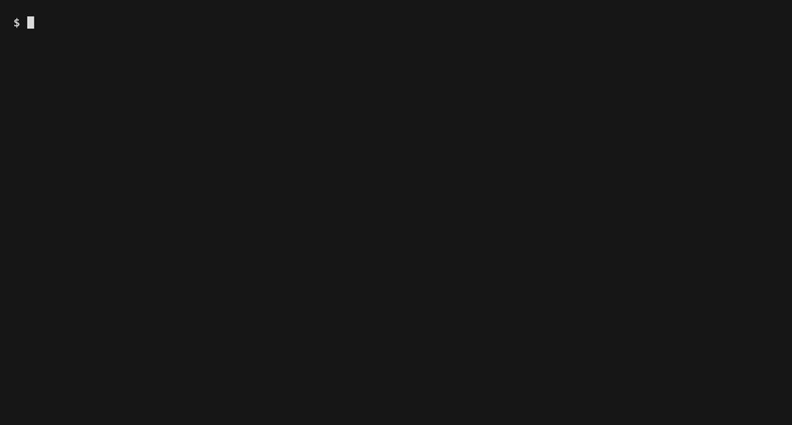

# depcage

[](https://github.com/Tarekkharsa/depcage/actions/workflows/test.yml)

Run `npm install`, your tests and your build inside an operating-system sandbox, with no
configuration.

```
depcage npm install
depcage npm test
```

A package you install runs with all of your permissions: it can read your SSH keys and
npm token, and send them anywhere. depcage runs the same command with:

- **your secrets unreadable** (SSH keys, npm and cloud logins, browser data, tokens in the environment)
- **the network limited** (installs reach only the package registry; everything else has no internet)
- **writes kept inside the project** (no changes to your shell start-up files, git hooks or home folder)

The sandbox itself is [`@anthropic-ai/sandbox-runtime`](https://github.com/anthropic-experimental/sandbox-runtime)
(`sandbox-exec` on macOS, `bubblewrap` on Linux). depcage adds the part that makes it usable
for JavaScript projects without writing a policy: it picks sensible rules from the command you run.

> Status: an early version. The tests and the demo run on macOS and Linux for every change. See [Tested with](#tested-with) and [Limits](#limits).

## See it work



`depcage demo` runs a harmless simulated attack twice, without and with the sandbox. It uses a
throw-away fake home folder with fake secrets, and its "attacker's server" is the demo itself on
your computer. It doubles as a self-test: it exits with an error if anything was not blocked.

```
During `npm install`: a dependency's install script tries to
                                                 without depcage   with depcage
  read your npm login token (~/.npmrc)           yes               blocked
  read your SSH private key (~/.ssh)             yes               blocked
  read a cloud API token from the environment    yes               blocked
  read the project's .env file                   yes               blocked
  add a line to ~/.zshrc so it runs again later  yes               blocked
  send what it found to the attacker's server    yes               blocked

During `npm test`: a dependency's code, loaded by your tests, tries to
                                                 without depcage   with depcage
  read your npm login token (~/.npmrc)           yes               blocked
  read your SSH private key (~/.ssh)             yes               blocked
  read a cloud API token from the environment    yes               blocked
  read the project's .env file                   yes               yes (tests need it)
  add a line to ~/.zshrc so it runs again later  yes               blocked
  send what it found to the attacker's server    yes               blocked
```

## Install

```
npm install -g depcage
```

Install it globally, not as a dependency of the project it protects. Requires Node 22.12 or
newer. macOS needs nothing else. Linux needs `bubblewrap`, `socat` and `ripgrep`.

## What each command gets

depcage looks at the command and picks one of two sets of rules.

| | Install commands | Everything else |
|---|---|---|
| Examples | `npm install`, `npm ci`, `pnpm add`, `yarn`, `bun install`, `npx`, `vp install` | `npm test`, `npm run build`, `node script.js`, `vitest`, `vp dev` |
| Internet | the package registry and `nodejs.org` only | off |
| Connections to this computer (localhost) | off | on, so dev servers and tests work |
| Secrets in your home folder | hidden | hidden |
| The project's `.env` files | hidden | readable |
| Secret-looking environment variables | not passed on | not passed on |
| Writing | the project and the package manager's download cache | the project |

"Secret-looking" means a name containing `TOKEN`, `SECRET`, `PASSWORD`, `API_KEY` and similar.
depcage prints the names it held back.

When something is blocked on the network, depcage tells you at the end and shows how to allow it:

```
depcage: blocked 1 network destination: example.com:443
depcage: if you trust one, run again with: depcage --allow-net example.com node …
```

## Options

Options go before the command.

| Option | Meaning |
|---|---|
| `--allow-net <host>` | also allow this host (`*.example.com` works) |
| `--allow-write <path>` | also allow writing to this path |
| `--allow-read <path>` | stop hiding this path, for example `~/.npmrc` |
| `--keep-env <NAME>` | pass this environment variable even if it looks secret |
| `--no-local` / `--local` | block or allow connections to this computer |
| `--mode <install\|run>` | choose the rules by hand |
| `--browser` | let the command start a browser (Playwright, Puppeteer) on macOS |
| `--print-policy` | show the rules for a command and exit |
| `-q`, `--quiet` | no summary lines |

Private registries: registries named in the project's `.npmrc` are allowed automatically. The
login for them usually lives in `~/.npmrc`, which is hidden; use `--allow-read ~/.npmrc`, or
keep the token in an environment variable and pass it with `--keep-env`.

## Vite+

depcage knows the `vp`, `vpx` and `vpr` commands of [Vite+](https://viteplus.dev), so no
options are needed:

```
depcage vp install        # install rules, with the caches of the package manager the project uses
depcage vp add left-pad
depcage vp dev            # run rules: no internet, dev server reachable from your browser
depcage vp test
depcage vp build
depcage vp run build      # task caching works inside the sandbox
```

Vite+ downloads Node.js and package managers into its own folder (`~/.vite-plus` or
`~/.local/share/vite-plus`). Those programs run outside the sandbox later, so depcage keeps
that folder read-only. When a project needs a version that is not downloaded yet, the install
stops with "Operation not permitted". Fetch it once outside depcage with a command that runs no
project code, then try again:

```
vp pm config get registry
```

For the same reason `vp env`, `vp upgrade` and `vp install -g` are not meant to be run
through depcage. Vite+ has no plugin system for its built-in commands, so depcage goes in front
of `vp`; it cannot be switched on from `vite.config.ts`.

## Tested with

Each of these was run through depcage with a fake home folder.

On macOS 27 (Apple silicon), Node 26:

- **Installs:** npm 11.20, pnpm 11.24 and 12.6, bun 1.4, yarn 1.22 (needs `--allow-read ~/.npmrc` when that file exists), `npx`
- **Install scripts and native builds:** esbuild, bcrypt, sharp, @parcel/watcher (`npm rebuild` with scripts approved)
- **Everyday commands:** TypeScript 7, ESLint, Prettier, Vitest, Vite build, Jest 30, webpack, a Next.js 16 production build, a test that starts a local HTTP server
- **Dev server:** `npx vite` is reachable from the browser and stops cleanly on Ctrl-C
- **yarn 4.18:** `yarn install`, `yarn add`, `yarn dlx`, `yarn test` on a machine with no Yarn cache yet
- **pnpm monorepo:** install at the root, `pnpm add` inside a package, `pnpm -r test`, `pnpm --filter`
- **Playwright 1.65:** a Chromium test with a local web server passes with `--browser` (see [Limits](#limits))
- **Vite+ 1.5** (with the real home folder, because Vite+ keeps its tools there): `vp install` with npm 11.20 and pnpm 12.21, `vp add`, `vp dlx`, `vpx`, `vp test`, `vp build`, `vp run` with a cache hit, `vp dev`
- **Overhead:** about half a second per command

On Linux (Debian in a privileged Docker container, arm64, Node 22, bubblewrap 0.8):

- the test suite and the demo
- `npm install` on a machine with no npm cache yet, Vitest, esbuild's native binary

On GitHub's macOS and Ubuntu runners, Node 22 and 24, for every change: the test suite and the demo.

Not tested yet: Windows (not supported; WSL 2 should behave like Linux), Firefox and WebKit in Playwright, Playwright on Linux, Turborepo and Nx.

## Limits

Read these before relying on it.

- **It is a sandbox around a whole command, not around one package.** It cannot say which
  dependency tried something, and it cannot stop one dependency from changing files of another
  inside the project.
- **The project folder stays writable.** Malicious code can still change your source files,
  `package.json` or `node_modules`. Git hooks and shell start-up files are protected, but what it
  changed runs with full permissions if you later run the project without depcage.
- **Download caches are writable during installs** (for example `~/.npm/_cacache`). A malicious
  install script could tamper with a cached package that a later, unsandboxed install uses.
- **On macOS, localhost is reachable outside installs.** Databases, dev servers or a local proxy
  on your computer can be reached by the code you run. Use `--no-local` when you do not need it.
- **On Linux, the sandbox has a localhost of its own.** A test that starts its own server works.
  A database running outside the sandbox cannot be reached, and a dev server started inside it
  cannot be opened from your browser. On Linux, use depcage for installs, tests and builds.
- **Secrets are hidden by a list.** A credential stored in an unusual place, or in the project
  folder itself, is not hidden. `.env` files are readable by tests and builds, though they cannot
  be sent to the internet.
- **An allowed host is fully allowed.** Traffic to it is not inspected. Be careful with hosts
  that accept uploads, such as `github.com`.
- **pnpm installs on macOS** may use the system certificate service, which pnpm 12 needs. The
  sandbox runtime documents this as a possible way to leak data.
- **Browser-side attacks are out of scope.** Code that only misbehaves in your users' browsers is
  not affected by a sandbox on your machine.
- **The blocked-action summary lists network destinations only.** Blocked file access shows up as
  an ordinary "operation not permitted" or "not found" error from the command. With Node 22 the
  summary also misses attempts made by Node's own `fetch`; they are blocked all the same.
- **Browser tests need `--browser` on macOS, and the browsers are downloaded outside depcage.**
  Chromium stops at start unless its processes may open a channel to each other; `--browser`
  allows exactly that channel, which could also reach another Chromium test browser running on
  your computer. Browser downloads (`npx playwright install`) come from general file hosts and
  land in a folder of programs, so run that command without depcage.
- **Yarn 1 stops when `~/.npmrc` or `~/.yarnrc.yml` exists**, because it cannot read a hidden
  file. Use `--allow-read` for that file. Yarn 2 and later is not affected. Switching a project
  from Yarn 1 to a newer Yarn (`yarn set version`) downloads from `github.com`; do that step
  without depcage.
- **`watchman` cannot be started inside the sandbox.** It talks to a daemon outside it, which
  would be a way out. Jest and similar tools fall back to their built-in file scanning.

## How it relates to other tools

- npm 11, pnpm 10+ and Bun do not run dependency install scripts unless you approve them. depcage
  covers what comes after: approved scripts, and code that runs during tests and builds.
- [sandbox-runtime](https://github.com/anthropic-experimental/sandbox-runtime) is the engine and
  can do everything here with a hand-written settings file.
- [LavaMoat](https://github.com/LavaMoat/LavaMoat) restricts individual packages inside the
  JavaScript runtime, which is finer-grained and more work to adopt.
- [Harden-Runner](https://github.com/step-security/harden-runner) limits network access in GitHub Actions.

## Development

```
npm install --ignore-scripts
npm test
```

The end-to-end tests run real commands through the sandbox against a temporary fake home folder.

## Licence

Apache-2.0
